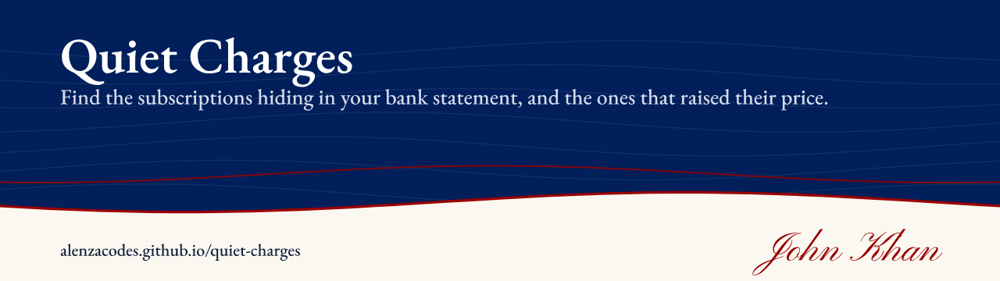
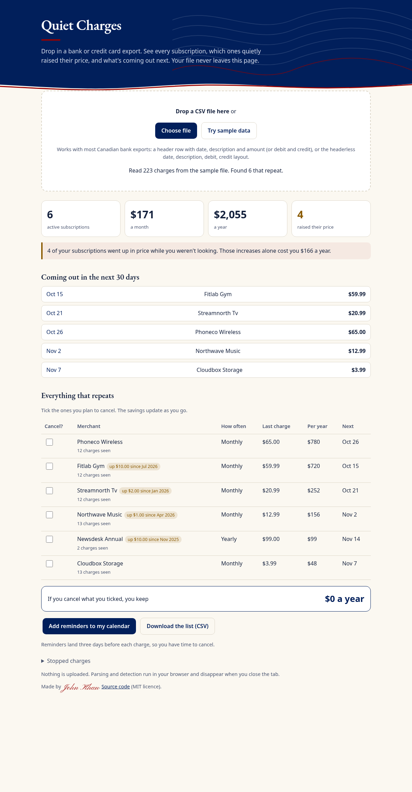
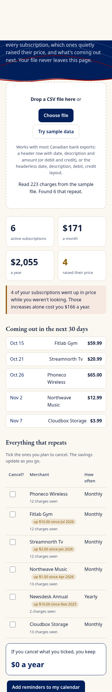

# Quiet Charges

**Live:** https://alenzacodes.github.io/quiet-charges/ (add `?sample` to load the sample data)

Subscriptions rarely announce a price increase. A streaming plan goes from $18.99 to $20.99, the gym adds $10, and nobody reads the email. Quiet Charges reads your bank or credit card export and shows:

- every charge that repeats, weekly, every two weeks, monthly, every three months or yearly
- which ones went up in price, by how much, and what those increases cost you over a year
- what's coming out in the next 30 days
- what you'd keep by cancelling the ones you tick
- a calendar file with a reminder three days before each charge, so you have time to cancel

It runs entirely in your browser. The file is never uploaded.

On a phone:

## How it works

1. **Reading the file.** A small CSV parser handles quoted fields and both line-ending styles. It finds the date, description and amount columns from the header, or falls back to the headerless date, description, debit, credit, balance layout some banks use. Dates can be ISO or month/day/year.
2. **Grouping by merchant.** Bank descriptions carry reference numbers and noise ("POS PURCHASE FITLAB GYM 00231"). These are stripped so the same merchant groups together.
3. **Finding the rhythm.** For each merchant it takes the gaps between charges, uses the median gap to match a cadence, and only counts it as recurring if at least 75% of the gaps fit and there are enough charges (three, or two for yearly). Charges whose amounts vary more than threefold, like groceries, are left out.
4. **Spotting increases.** Any rise of more than 2% and at least 50 cents between charges counts as an increase.
5. **Looking ahead.** The next date is the last charge plus the cadence. A merchant that has missed two cycles is marked as stopped.

All of this is in `src/engine.js`.

## Run it

    python3 -m http.server 8000

then open http://localhost:8000/.

## Tests

Needs Node 20 or later. No dependencies.

    node --test

12 tests cover CSV edge cases, date and amount parsing, both file layouts, merchant name cleaning, cadence detection, false positives from random spending, price increase and stopped-subscription detection, the sample file end to end, and the calendar file. They run on every push through GitHub Actions.

## Files

    index.html              the page
    src/engine.js           CSV parsing, merchant grouping, cadence and price-increase detection, calendar file
    src/app.js              the interface
    src/style.css
    src/sample.csv          made-up sample statement
    tests/engine.test.js    unit tests

## Limits

- A subscription billed at irregular dates, or under a changing merchant name, may be missed.
- Amounts in foreign currency are read as they appear in the export.

## Sample data
`src/sample.csv` is made up. The merchant names are fictional.

## Licence
MIT. Copyright 2026 John Khan.
