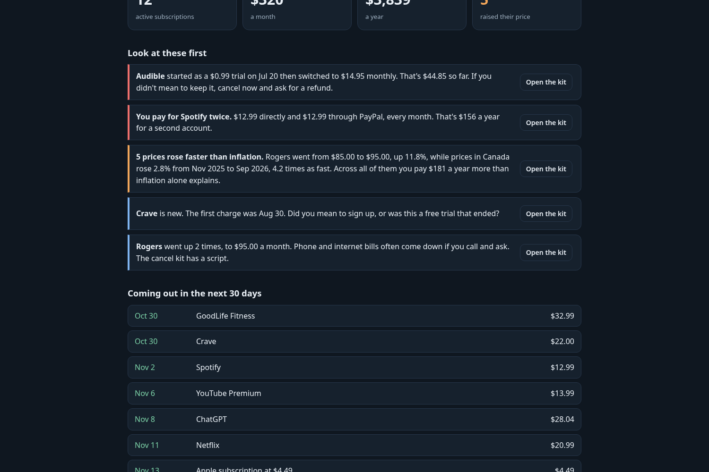

# Quiet Charges

Your bank statement knows about every subscription you forgot. Quiet Charges reads it and tells you, in plain words:

* every charge that repeats: weekly, every two weeks, monthly, every three months or yearly
* **free trials that turned into charges** (a $0.99 or $1 first charge, then full price)
* **services you pay for twice**, like Spotify billed directly and again through PayPal
* **price increases compared with inflation**, using Statistics Canada's Consumer Price Index for the same months
* what's coming out in the next 30 days, and what you keep each year by cancelling what you tick
* a **cancel kit** for 36 common Canadian subscriptions: the official help page, short steps and a message ready to send, which also asks for a refund after a trial
* for phone and internet bills, a short **script to ask for a lower price** that quotes your own increases
* a calendar file with a reminder three days before each charge, with the cancel link inside

It runs entirely in your browser. A Content Security Policy in the page stops it from contacting any other server, and the browser check below proves it.

Live: https://alenzacodes.github.io/quiet-charges/ (add `?sample` to load a year of sample data)

## What it reads
* **CSV** from Canadian banks and cards. It finds the date, description and amount columns from the header (RBC, BMO, Tangerine and similar layouts are tested), skips account details above the header, handles separate debit and credit columns, the headerless date, description, debit, credit layout (TD, CIBC), semicolons, and day first dates.
* **OFX and QFX**, the "Money" or "Quicken" download most banks offer.
* **Text pasted from a PDF statement**: lines with a transaction date, an optional posting date, the merchant and an amount. Missing years are filled in, and payments and refunds marked CR are skipped.
* **Several files at once.** They are merged and overlapping days are counted once.

## How it works
All of the logic is in `src/engine.js`, as pure functions that run the same in the browser and in Node.

1. **Grouping.** Each description is matched against the service list in `src/catalog.js`, which also sees through payment wrappers such as `PAYPAL *SPOTIFY`. Unknown merchants are grouped by a cleaned name with reference numbers, phone numbers and province codes removed. Apple and Google Play bills are split by price, because one Apple charge can be several different apps.
2. **Finding the rhythm.** For each group it takes the gaps between charges, matches the median gap to a cadence, and keeps it only if at least 75% of the gaps fit. Unknown merchants also need steady amounts, so groceries, coffee and rides drop out. Rent, transfers and payroll are never counted.
3. **Trials.** A first charge under a quarter of the regular price, 3 to 45 days before it, is peeled off as a trial. The trial is not counted as a price increase.
4. **Exchange rates.** A US dollar subscription wobbles up and down with the exchange rate. If the amount changes direction twice or more within a narrow band, it is labelled as foreign currency instead of a price increase.
5. **Inflation.** For each subscription that went up, it compares the rise with the all items CPI for Canada between the first and last charge, and works out what the price would be if it had only kept up with inflation.
6. **New and stopped.** A subscription is called new only if the file reaches back far enough to have shown an earlier charge. One that missed two cycles is marked as stopped.

## Data sources
* `src/cpi.js`: Statistics Canada table 18-10-0004-01, all items CPI for Canada (vector V41690973), January 2023 to September 2026, read from the Bank of Canada Valet API on October 29, 2026.
* `src/catalog.js`: 36 services. Every link was opened on October 29, 2026. The steps are short summaries; the linked page is the source of truth.
* `src/sample.csv`, `docs/sample-statement.txt`, `docs/sample.qfx`: made up. The service names are real so the cancel kit can be shown working, but every amount and date is invented. `node scripts/make-sample.mjs` rebuilds them.

## Run it

    python3 -m http.server 8000

then open http://localhost:8000/. There is no build step and nothing to install.

## Tests
Needs Node 20 or later. No dependencies.

    node --test

36 tests cover CSV edge cases and four real bank layouts, OFX, pasted statement text, merging, merchant matching, cadence detection, trials, paying twice, exchange rate wobble, the inflation maths, the full sample year, the cancel message, the phone script, calendar line folding, and a thousand random purchases that must not produce a single false subscription.

The browser check serves the site, loads it in headless Chrome, opens a cancel kit, reads pasted text, confirms there are no console errors and confirms that a request to an outside server is blocked:

    pip install playwright
    python3 scripts/browser_check.py          # add --shots to refresh the screenshots
    python3 scripts/record_demo.py            # records the captioned demo video

## Licence
MIT. Copyright 2026 John Khan.
